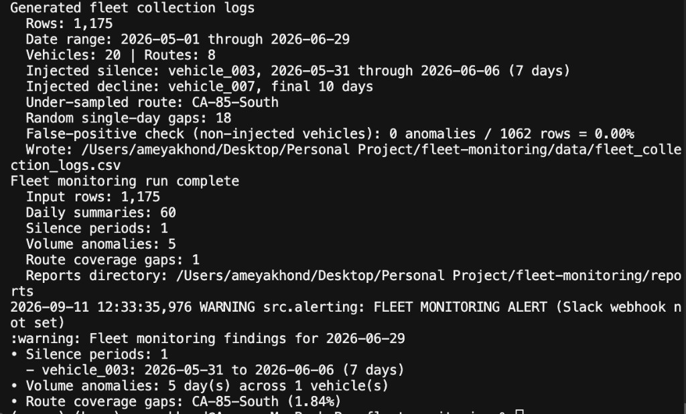
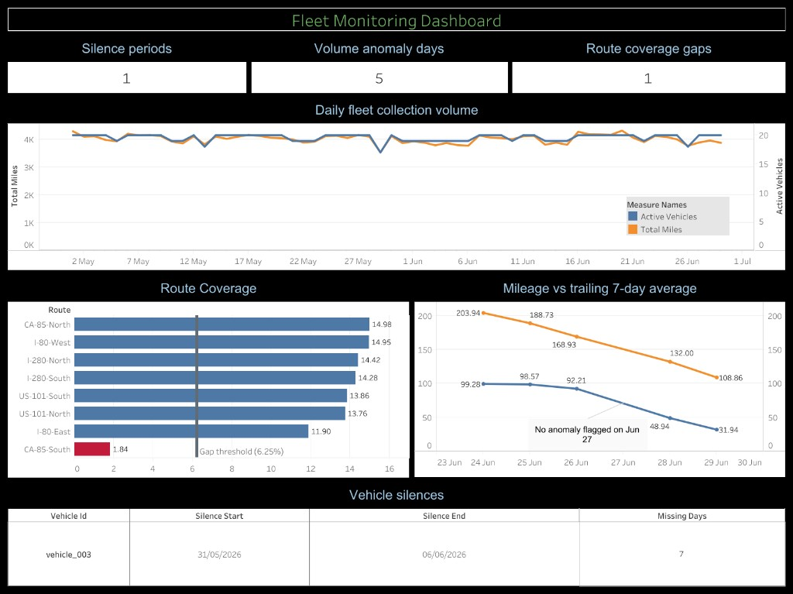

# Fleet Monitoring

Fleet Monitoring tracks the health of a simulated AV fleet's ongoing highway
data collection. It detects three operational failure modes:

1. **Vehicle silence** — vehicles that stop reporting for consecutive calendar days.
2. **Volume anomalies** — per-vehicle daily mileage drops relative to that vehicle's own recent baseline.
3. **Route coverage gaps** — highways that are systematically under-sampled relative to the network.

The project is fully self-contained: `src/generate_fleet_data.py` creates the
synthetic collection logs, so no external dataset is required.

Two execution paths implement the same four checks with matching intended
semantics:

- **Local pandas** — verified reference path (`local_runner/run_monitoring.py`).
- **Databricks / PySpark** — **remaining / not yet completed.** The notebook
  (`notebooks/fleet_monitoring_job.py`) and Jobs JSON are written, but the
  Databricks work has **not** been executed or verified end-to-end on a live
  Databricks workspace yet. See [Databricks path](#databricks-path).

> **Project status:** the local pandas pipeline, unit tests, and Tableau
> dashboard are complete and verified. **Databricks execution/verification is
> the remaining work** — do not treat the PySpark notebook or Jobs schedule as
> deployed/validated until it has been run on a live workspace.
 
## Status summary

| Component | Status |
| --- | --- |
| Local pandas pipeline | Verified, tested, run output included |
| Unit tests | Passing (`python -m pytest -v`) |
| Tableau ops dashboard | Built from verified report CSVs |
| Databricks notebook + Jobs JSON | **Remaining — written, not yet run/verified on a live workspace** |
| CI | None present |

---

## Table of contents

- [Key concepts and design decisions](#key-concepts-and-design-decisions)
- [Architecture](#architecture)
- [Repository layout](#repository-layout)
- [Data model](#data-model)
- [Synthetic data generator](#synthetic-data-generator)
- [Monitoring checks (semantics)](#monitoring-checks-semantics)
- [Alerting](#alerting)
- [Local pipeline runner](#local-pipeline-runner)
- [Quick start](#quick-start)
- [Command reference](#command-reference)
- [Expected output](#expected-output)
- [Verified run](#verified-run)
- [Tableau dashboard](#tableau-dashboard)
- [Databricks path](#databricks-path)
- [pandas to PySpark mapping](#pandas-to-pyspark-mapping)
- [Testing](#testing)
- [Configuration and tuning](#configuration-and-tuning)
- [Design constraints honored](#design-constraints-honored)
- [Known limitations](#known-limitations)

---

## Key concepts and design decisions

**Per-vehicle baselines, not fleet-wide comparisons.** Vehicles collect on
routes of different natural lengths. Comparing any vehicle against a
fleet-wide average would permanently flag short-route vehicles. Every volume
check therefore compares a vehicle only against its *own* recent history.

**Pure, side-effect-free checks.** `src/monitoring.py` is DataFrame-in /
DataFrame-out only: no file, network, logging, or environment access. I/O and
alerting stay at the edges, so the checks are independently unit-testable.

**Location-independent execution.** The local runner resolves input and output
paths from its own file location, so it behaves the same regardless of the
caller's working directory.

### Calibration bug and fix (false-positive story)

An early version of the generator drew each day's mileage independently from a
wide random range, with no day-to-day autocorrelation. Under that data, a
rolling-average anomaly detector using a 40% drop threshold false-flagged
roughly **~20% of completely normal vehicle-days**, because there was no stable
signal for the rolling baseline to represent.

The fix was to give each vehicle a **stable baseline daily mileage** and add
only modest Gaussian day-to-day noise (~8% of that baseline). After the change:

| Metric | Before | After |
| --- | --- | --- |
| False positives on non-injected vehicles | ~20% of normal vehicle-days | **0%** (`0 / 1062` rows) |
| Detection of injected decline anomaly | Present | Still caught (5 flagged days) |

A unit test with 3,600 stable low-noise rows (`tests/test_monitoring.py`)
guards against regressions of this class.

---

## Architecture

```text
                         +---------------------------+
                         | Synthetic fleet generator |
                         | 20 vehicles / 8 routes    |
                         |  (fixed random seed)      |
                         +-------------+-------------+
                                       |
                              fleet_collection_logs.csv
                                       |
                    +------------------+-------------------+
                    |                                      |
          +---------v-----------+              +-----------v---------+
          | Local pandas runner |              | Databricks notebook |
          | verified locally    |              | designed PySpark    |
          +---------+-----------+              +-----------+---------+
                    |                                      |
          +---------v-----------+              +-----------v---------+
          | reports/*.csv       |              | Delta result tables |
          | Slack/logging alert |              | notebook.exit()     |
          +---------------------+              +---------------------+

          Shared logic (matching intended semantics on both paths):
            1. daily_fleet_summary
            2. detect_vehicle_silence
            3. detect_volume_anomalies
            4. route_coverage_summary
```

The left-hand local branch has been run end-to-end. The right-hand Databricks
branch is the intended lakehouse mirror; see [Databricks path](#databricks-path)
for verification status.

---

## Repository layout

```text
fleet-monitoring/
├── src/
│   ├── generate_fleet_data.py   # synthetic fleet collection logs
│   ├── monitoring.py            # core checks (pure pandas functions)
│   └── alerting.py              # Slack webhook alerting w/ logging fallback
├── local_runner/
│   └── run_monitoring.py        # end-to-end local pipeline runner
├── notebooks/
│   └── fleet_monitoring_job.py  # Databricks notebook (intended PySpark mirror)
├── databricks_jobs/
│   └── monitoring_job.json      # Databricks Jobs API schedule (reference)
├── tests/
│   └── test_monitoring.py       # pytest unit tests on small DataFrames
├── data/
│   └── fleet_collection_logs.csv  # generated (git-ignored)
├── reports/                     # generated CSV reports (git-ignored)
├── docs/
│   └── images/
│       ├── fleet_monitoring_dashboard.png
│       └── local_pipeline_verified_run.png
├── requirements.txt             # pandas, requests, pytest
├── .gitignore
└── README.md
```

`data/`, `reports/`, and the virtual environment are git-ignored and regenerated
on demand. Screenshots under `docs/images/` are committed.

---

## Data model

Each row in `data/fleet_collection_logs.csv` is one vehicle's collection
activity for one calendar day.

| Column | Type | Description |
| --- | --- | --- |
| `date` | date | Calendar day of collection |
| `vehicle_id` | string | Stable vehicle ID, e.g. `vehicle_003` |
| `route` | string | Highway route, e.g. `I-280-North` |
| `miles_collected` | float | Miles of data collected that day |
| `hours_collected` | float | Hours spent collecting that day |
| `disengagement_events` | int | Disengagement count that day |

Routes: `I-280-North`, `I-280-South`, `US-101-North`, `US-101-South`,
`I-80-East`, `I-80-West`, `CA-85-North`, `CA-85-South`.

A missing day for a vehicle is represented by the **absence of a row**, not by a
zero-valued row. That is what makes silence detection meaningful.

---

## Synthetic data generator

`src/generate_fleet_data.py` produces 60 days of logs for 20 vehicles across 8
routes, using fixed seed `42`.

Each vehicle gets a stable baseline daily mileage (roughly 155–245 miles). Each
day's mileage is that baseline plus ~8% Gaussian noise, so consecutive days are
correlated. See [Calibration bug and fix](#calibration-bug-and-fix-false-positive-story)
for why that matters.

**Deliberately injected anomalies:**

| Anomaly | Where | Detail |
| --- | --- | --- |
| Full silence | `vehicle_003` | Zero rows for 7 days (2026-05-31 → 2026-06-06) |
| Gradual decline | `vehicle_007` | Mileage multiplier ramps 0.95 → 0.20 over the last 10 days |
| Under-sampled route | `CA-85-South` | Weighted sampling collects far fewer miles |
| Random single-day gaps | 18 gaps on other vehicles | Isolated missing days; never adjacent; excludes the two anomaly vehicles |

The generator also prints a false-positive calibration check for non-injected
vehicles. After the baseline fix, that check reports `0.00%`.

---

## Monitoring checks (semantics)

All four live in `src/monitoring.py` as pure functions.

### 1. `daily_fleet_summary(df)`

One row per calendar day:

- `total_miles` — sum of `miles_collected`
- `total_hours` — sum of `hours_collected`
- `active_vehicles` — distinct reporting vehicles

### 2. `detect_vehicle_silence(df, threshold_days=3)`

Builds the full observed calendar range, then finds every consecutive run of
missing days per vehicle. Returns **one row per silence period** (not per
vehicle), because a vehicle can have multiple separate outages. Only runs of
length `>= threshold_days` are returned.

Output: `vehicle_id`, `silence_start`, `silence_end`, `missing_days`.

### 3. `detect_volume_anomalies(df, rolling_window_days=7, drop_threshold_pct=0.4)`

For each vehicle independently, compares each day's mileage against **that same
vehicle's** trailing rolling average over the prior `rolling_window_days`
calendar days. The current day is excluded from its own baseline
(`closed="left"`). A day is flagged when:

```text
(trailing_avg_miles - miles_collected) / trailing_avg_miles >= drop_threshold_pct
```

Output: `date`, `vehicle_id`, `miles_collected`, `trailing_avg_miles`, `drop_pct`.

### 4. `route_coverage_summary(df)`

Totals mileage per route and computes each route's share of fleet mileage. A
route is a coverage gap when its share is below **half of an even split**. With
8 routes, even split is 12.5%, so the gap threshold is 6.25%.

Output: `route`, `total_miles`, `share_pct`, `coverage_gap`.

---

## Alerting

`src/alerting.py` provides:

- **`send_alert(message)`** — if `SLACK_WEBHOOK_URL` is set, posts to Slack;
  otherwise logs the alert via the `logging` module. Network failures also fall
  back to logging. The no-webhook logging path has been verified in a real
  local run; live Slack delivery has not been exercised in this project.
- **`build_daily_alert_summary(...)`** — builds one combined alert from the
  check outputs, or returns `None` when nothing needs flagging. It does not
  emit a "no issues" message on healthy runs.

---

## Local pipeline runner

`local_runner/run_monitoring.py` is the verified end-to-end entry point. It:

1. Resolves the project root from its own file location.
2. Loads `data/fleet_collection_logs.csv`.
3. Runs all four checks from `src/monitoring.py`.
4. Writes CSV reports into `reports/`.
5. Prints a console summary.
6. Calls `send_alert()` only if `build_daily_alert_summary()` returns a message.

Reports written:

- `reports/daily_fleet_summary.csv`
- `reports/vehicle_silences.csv`
- `reports/volume_anomalies.csv`
- `reports/route_coverage.csv`

---

## Quick start

Python 3.10+ recommended.

```bash
cd fleet-monitoring
python -m venv .venv
source .venv/bin/activate
python -m pip install -r requirements.txt

python src/generate_fleet_data.py
python -m pytest
python local_runner/run_monitoring.py
```

Use `python -m pytest`, not a bare `pytest`. `python -m pytest` puts the
project root on `sys.path` so `from src.monitoring import ...` resolves. A bare
`pytest` from a different interpreter on `PATH` can fail with
`ModuleNotFoundError: No module named 'src'`.

---

## Command reference

| Goal | Command |
| --- | --- |
| Create environment | `python -m venv .venv` |
| Activate environment | `source .venv/bin/activate` |
| Install dependencies | `python -m pip install -r requirements.txt` |
| Generate data + calibration check | `python src/generate_fleet_data.py` |
| Run tests | `python -m pytest` |
| Run tests (verbose) | `python -m pytest -v` |
| Run full local pipeline | `python local_runner/run_monitoring.py` |
| Run everything, stop on first failure | `python src/generate_fleet_data.py && python -m pytest && python local_runner/run_monitoring.py` |
| Enable Slack alerts | `export SLACK_WEBHOOK_URL="https://hooks.slack.com/..."` then run the runner |

Optional generator output path:

```bash
python src/generate_fleet_data.py --output /tmp/logs.csv
```

---

## Expected output

Generator (`python src/generate_fleet_data.py`) with seed `42` is designed to
reproduce this summary:

```text
Generated fleet collection logs
  Rows: 1,175
  Date range: 2026-05-01 through 2026-06-29
  Vehicles: 20 | Routes: 8
  Injected silence: vehicle_003, 2026-05-31 through 2026-06-06 (7 days)
  Injected decline: vehicle_007, final 10 days
  Under-sampled route: CA-85-South
  Random single-day gaps: 18
  False-positive check (non-injected vehicles): 0 anomalies / 1062 rows = 0.00%
  Wrote: .../fleet-monitoring/data/fleet_collection_logs.csv
```

---

## Verified run

The following is **real output from an actual local execution** of data
generation and `local_runner/run_monitoring.py` (not a hypothetical example):



```text
Fleet monitoring run complete
  Input rows: 1,175
  Daily summaries: 60
  Silence periods: 1
  Volume anomalies: 5
  Route coverage gaps: 1
  Reports directory: .../fleet-monitoring/reports
WARNING src.alerting: FLEET MONITORING ALERT (Slack webhook not set)
:warning: Fleet monitoring findings for 2026-06-29
• Silence periods: 1
  - vehicle_003: 2026-05-31 to 2026-06-06 (7 days)
• Volume anomalies: 5 day(s) across 1 vehicle(s)
• Route coverage gaps: CA-85-South (1.84%)
```

These findings match the injected anomalies: the 7-day silence on
`vehicle_003`, the gradual decline on `vehicle_007` (5 flagged days), and the
under-covered `CA-85-South` route. The Slack fallback logged the alert instead
of failing when `SLACK_WEBHOOK_URL` was unset. The generator also reported
`0 anomalies / 1062 rows = 0.00%` false positives on non-injected vehicles.

---

## Tableau dashboard

Ops dashboard built on the verified monitoring outputs from the local pandas
pipeline. It surfaces the three failure modes the project detects: vehicle
silence, per-vehicle volume anomalies, and route coverage gaps.



### What the dashboard shows

| KPI | Value | Meaning |
| --- | --- | --- |
| Silence periods | **1** | Vehicles with multi-day reporting outages |
| Volume anomaly days | **5** | Days flagged by the 40% drop detector |
| Route coverage gaps | **1** | Routes below half of an even mileage split |

**Charts**

1. **Daily fleet collection volume** — dual-axis trend of total miles and
   active vehicles across the 60-day window (May–June 2026).
2. **Route Coverage** — mileage share by route, colored by `coverage_gap`,
   with a **6.25%** gap threshold line. `CA-85-South` at **1.84%** is the
   flagged route.
3. **Mileage vs trailing 7-day average** — detector output for
   `vehicle_007`: daily miles vs that vehicle’s own trailing average on
   flagged days only (late June). Jun 27 has no anomaly row, so it appears
   as a gap.
4. **Vehicle silences** — detail table for the outage:

   | Vehicle Id | Silence Start | Silence End | Missing Days |
   | --- | --- | --- | --- |
   | vehicle_003 | 2026-05-31 | 2026-06-06 | 7 |

### Tableau data sources

Built from the CSV reports produced by `local_runner/run_monitoring.py`:

```text
reports/daily_fleet_summary.csv
reports/vehicle_silences.csv
reports/volume_anomalies.csv
reports/route_coverage.csv
```

These are separate grains (date, silence period, anomaly day, route), so each
sheet uses its own Tableau data source. The dashboard is designed as a
**findings triage view**, not an ad-hoc exploration cube. Broad
cross-dashboard filters are intentionally minimal: the report files are
already exception-focused (one silence vehicle, one anomaly vehicle, one gap
route).

### How to recreate the dashboard

1. Generate reports:

```bash
cd fleet-monitoring
source .venv/bin/activate
python src/generate_fleet_data.py
python local_runner/run_monitoring.py
```

2. In Tableau, connect the four report CSVs as separate text data sources.
3. Build sheets:
   - KPI Silence → `COUNTD(Vehicle Id)` on `vehicle_silences`
   - KPI Anomalies → count of anomaly days on `volume_anomalies`
   - KPI Coverage → count of `coverage_gap = True` on `route_coverage`
   - Fleet trend → dual-axis `Total Miles` + `Active Vehicles` by continuous date
   - Route Coverage → horizontal bars of `Share Pct` by `Route`, color by gap, reference line at 6.25
   - Mileage vs trailing average → dual-axis miles vs trailing avg (synchronize axes)
   - Vehicle silences → text table
4. Assemble a tiled dashboard:
   - Title
   - KPI row (3 equal tiles)
   - Fleet chart (full width)
   - Route Coverage | Mileage chart
   - Vehicle silences table
5. Export: **Dashboard → Export Image…**

### Tableau design notes

- **No broad filters by default.** The monitoring outputs are already
  exception-focused, so generic filters add little value.
- **Anomaly chart date range is late June only** because
  `volume_anomalies.csv` stores detector hits, not the full season.
- **Synthetic data** is used for reproducibility and labeled ground-truth
  anomalies. The same visual pattern applies to real telematics / AV mileage
  feeds after aggregation to daily vehicle/route tables.

---

## Databricks path

> **Remaining work:** the Databricks work is **not yet completed**. The notebook
> and Jobs definition are written, but they have not been executed or verified
> end-to-end on a live Databricks workspace. Treat this section as planned /
> intended behaviour, not as a deployed or validated result.

**Status:** this path is written and structurally complete, but it has **not**
yet been run end-to-end on a live Databricks workspace. The local path
(`local_runner/run_monitoring.py`) is the verified reference implementation.
The core algorithms are already proven correct via the local test suite and the
[verified run](#verified-run), so Databricks execution risk is primarily about
workspace-path or runtime-version friction, not logic errors in the monitoring
checks themselves. The remainder of this section describes intended behavior
and the manual steps to validate it.

`notebooks/fleet_monitoring_job.py` reimplements the four checks in PySpark
against Delta tables. It uses Databricks notebook source format
(`# COMMAND ----------` cell breaks and `# MAGIC %md` markdown cells).

It is designed to:

1. Read `fleet_monitoring.raw_collection_logs`.
2. Write four result Delta tables.
3. Exit via `dbutils.notebook.exit(...)` with a JSON summary (`HEALTHY` or
   `ATTENTION_REQUIRED` plus finding counts).

### Running the notebook manually (reliable free-tier path)

1. Create the schema:

   ```sql
   CREATE SCHEMA IF NOT EXISTS fleet_monitoring;
   ```

2. Upload `data/fleet_collection_logs.csv` and create Delta table
   `fleet_monitoring.raw_collection_logs` (Community Edition: typically
   **Data → Create Table / Upload File**, or load from DBFS in a notebook).
3. Import `notebooks/fleet_monitoring_job.py` as a notebook.
4. Attach compute and **Run all**.
5. Inspect output tables: `daily_fleet_summary`, `vehicle_silences`,
   `volume_anomalies`, `route_coverage`.

### Scheduling (reference)

`databricks_jobs/monitoring_job.json` is a reference Jobs API 2.1 definition
intended to:

- schedule the notebook daily at 06:00 UTC via `quartz_cron_expression`;
- define a single-node `new_cluster` spec;
- email on failure; and
- include a placeholder `webhook_notifications` block.

Before using it in a paid workspace, replace the Git URL, email address,
webhook destination ID, and cluster fields. Community Edition limitations for
Jobs/webhooks are listed under [Known limitations](#known-limitations).

---

## pandas to PySpark mapping

The rolling anomaly check is the most important translation. The mapping below
is the **intended** calendar-time equivalent of the verified pandas logic; it
has not yet been executed on a live Databricks workspace. See
[Databricks path](#databricks-path).

**pandas** (verified locally):

```python
vehicle_rows["miles_collected"].rolling("7D", closed="left").mean()
```

**PySpark** (designed equivalent):

```python
seconds_per_day = 86_400
trailing_window = (
    Window.partitionBy("vehicle_id")
    .orderBy(F.col("date").cast("timestamp").cast("long"))
    .rangeBetween(-7 * seconds_per_day, -seconds_per_day)
)
F.avg("miles_collected").over(trailing_window)
```

`rangeBetween` operates on the ordering value in seconds, so it is intended as
a true calendar-time window (not a row-count window), matching pandas `"7D"`
semantics even when days are missing. Bounds `-7 * 86400` through `-86400`
are meant to reproduce `closed="left"`.

---

## Testing

`tests/test_monitoring.py` uses only small hand-built DataFrames (never the
generated CSV):

- Daily aggregation correctness
- Silence threshold boundary (3-day flagged, 2-day not)
- Volume anomaly on a clear per-vehicle drop (long-route steady vehicle not flagged)
- No false positives across 3,600 stable low-noise rows (guards the calibration bug)

```bash
python -m pytest -v
```

---

## Configuration and tuning

| Parameter | Location | Default | Effect |
| --- | --- | --- | --- |
| `threshold_days` | `detect_vehicle_silence` | `3` | Minimum consecutive missing days to flag silence |
| `rolling_window_days` | `detect_volume_anomalies` | `7` | Trailing per-vehicle baseline window |
| `drop_threshold_pct` | `detect_volume_anomalies` | `0.4` | Fractional drop vs baseline to flag a day |
| coverage gap ratio | `route_coverage_summary` | `0.5` | Fraction of even-split share below which a route is a gap |
| `RANDOM_SEED` | `generate_fleet_data.py` | `42` | Reproducible synthetic data |
| `SLACK_WEBHOOK_URL` | environment | unset | Slack delivery when set; otherwise logging fallback |

---

## Design constraints honored

- No hardcoded absolute paths in source
- `monitoring.py` has zero I/O or side effects
- Local dependencies are only `pandas`, `requests`, and `pytest`
- Reproducible via fixed seed and fixed date range
- Location-independent runner paths

---

## Known limitations

- **Databricks Community Edition / free tier** may not support importing
  multi-task Jobs JSON, creating scheduled jobs, custom job clusters, or webhook
  notifications. Running the notebook manually is the reliable demo path on the
  free tier.
- **Silence detection sees only known vehicles.** It can evaluate only vehicle
  IDs that appear somewhere in the observed dataset. A vehicle that never
  emitted any row would need a separate fleet registry to be detectable.
- **Full-scan processing.** The local runner re-evaluates the entire CSV every
  run rather than incrementally processing newly arrived data.
- **Basic Slack integration.** The sample webhook payload has no retries,
  secret-manager integration, or alert deduplication. Live Slack delivery has
  not been verified in this project; only the logging fallback has.
